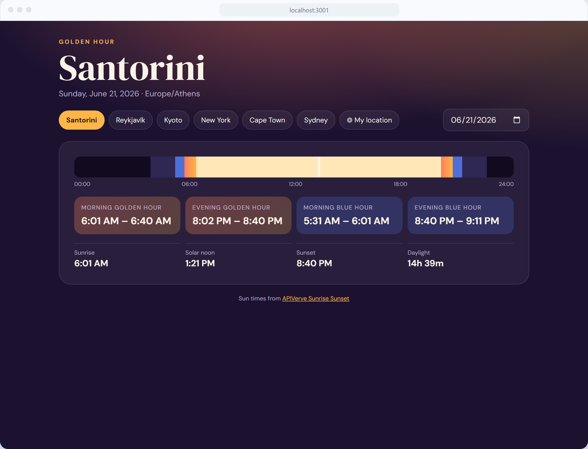

# Golden Hour | APIVerve Template

[](LICENSE)
[](package.json)
[](tsconfig.json)
[](https://apiverve.com/marketplace/sunrisesunset?utm_source=github&utm_medium=template&utm_campaign=golden-hour-nextjs-tutorial)

A golden hour planner you can deploy in one click. Pick a place and a day and see the morning and evening golden hours, the blue hours, sunrise, sunset and how long the day is, all in the place's own time, with the whole day drawn as a band of light from midnight to midnight. Made for photographers, filmmakers and anyone planning a sunset.

[](https://vercel.com/new/clone?repository-url=https%3A%2F%2Fgithub.com%2Fapiverve%2Fgolden-hour-nextjs-tutorial&project-name=golden-hour&repository-name=golden-hour&env=APIVERVE_API_KEY&envDescription=Your%20APIVerve%20API%20key.%20Free%20to%20create%2C%20no%20card%20needed.&envLink=https%3A%2F%2Fdashboard.apiverve.com%2Fsignup%3Fapi%3Dsunrisesunset%26utm_source%3Dvercel%26utm_medium%3Dtemplate%26utm_campaign%3Dgolden-hour-nextjs-tutorial)



---

### Get your free API key

This template needs an APIVerve API key. **[Sign up free](https://dashboard.apiverve.com/signup?api=sunrisesunset&utm_source=github&utm_medium=template&utm_campaign=golden-hour-nextjs-tutorial)**, no credit card required.

---

## Deploy in one click

Click **Deploy with Vercel** above. Vercel copies this repo to your GitHub account, asks for your `APIVERVE_API_KEY`, and gives you a live URL about a minute later.

## Run it locally

```bash
git clone https://github.com/apiverve/golden-hour-nextjs-tutorial.git
cd golden-hour-nextjs-tutorial
npm install
cp .env.example .env   # then set APIVERVE_API_KEY in .env
npm run dev
```

Open `http://localhost:3000`. To see it in a phone and a browser frame side by side, open `http://localhost:3000/showcase.html`.

## How it works

1. `app/page.tsx` has the place chips, a date picker and a My location button. It opens on `?lat=36.46&lon=25.38&name=Santorini&date=2026-06-21`, or Santorini today.
2. `app/api/sun/route.ts` checks the coordinates and date, then calls Sunrise Sunset with `local=true` so the answer includes the place's timezone. Your API key stays on the server and never reaches the browser. Answers are cached for a day, and cached answers don't count against the rate limit.
3. The page turns the UTC times into the place's local time with the browser's own `Intl` API and lays them out as bands: night, twilight, blue hour, golden hour and day. Polar days and nights, where some times don't exist, just drop their band.

Everything here works on a free key: sunrise, sunset, dawn, dusk, the golden hour times and the timezone are all free. Paid plans add solar noon and ready-made local times.

```
app/
  api/sun/route.ts    the server route: validates, calls Sunrise Sunset, caches
  page.tsx            the place picker, day bar and golden and blue hour cards
  layout.tsx          fonts and metadata
  globals.css         the look, with container queries for phone and desktop
lib/
  apiverve.ts         API call, cache and rate limit helpers
public/showcase.html  the phone and desktop demo frame
```

### The API call

```ts
const res = await fetch('https://api.apiverve.com/v1/sunrisesunset?lat=36.46&lon=25.38&date=06-21-2026&local=true', {
  headers: { 'x-api-key': process.env.APIVERVE_API_KEY! }
});
const { data } = await res.json();
```

## Before you share your URL

Once deployed, anyone who finds your URL can use it on your API key. Each visitor can make 10 uncached requests a minute, and repeat lookups come from the cache, which is fine for a demo. Both are kept in memory, so they aren't shared between serverless instances. For production:

- Put the page behind your own sign-in, or
- Move the limit and cache to a shared store such as [Upstash Redis](https://upstash.com/), or
- Call the route only from your own backend.

## Ideas to extend it

- Add the weather at golden hour with [Weather](https://apiverve.com/marketplace/weatherforecast), so you know if the sky will be clear.
- Show the moon phase for night shoots with [Moon Phases](https://apiverve.com/marketplace/moonphases).
- Search places by name instead of chips with [Cities Lookup](https://apiverve.com/marketplace/citieslookup).

## API reference

- [Sunrise Sunset](https://apiverve.com/marketplace/sunrisesunset?utm_source=github&utm_medium=template&utm_campaign=golden-hour-nextjs-tutorial): `GET https://api.apiverve.com/v1/sunrisesunset`
- [Full documentation](https://docs.apiverve.com?utm_source=github&utm_medium=template&utm_campaign=golden-hour-nextjs-tutorial)

## Tech stack

- **Next.js 16** (App Router) and **React 19**, in **TypeScript**
- A **Route Handler** in `app/api/` for the server side, so the key never reaches the browser
- Deploys to Vercel as-is, with no configuration

## License

MIT. See [LICENSE](LICENSE).
